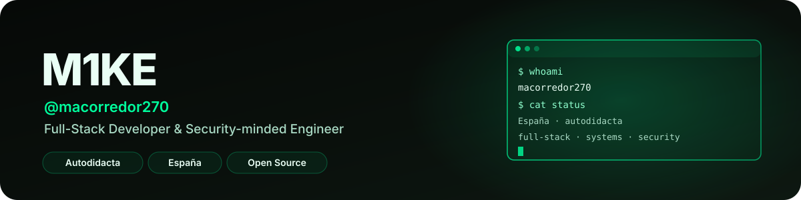

  

  
  
  
  

  $ whoami · <b>14 años · España · autodidacta</b> · fútbol de competición, código en el tiempo libre

---

De forma totalmente autodidacta, diseño y desarrollo soluciones completas: desde landing pages
comerciales y paneles operativos internos para logística hasta plataformas web complejas y
sistemas operativos a bajo nivel. Todo el detalle, con casos de estudio, está en
**[mikedev.duckdns.org](https://mikedev.duckdns.org)** — esta página se mantiene sincronizada con
ese portfolio.

## Principios de trabajo

| | |
|---|---|
| **Aprender construyendo** | Sin bootcamps ni atajos teóricos. El aprendizaje real viene de crear sistemas en producción y resolver incidentes técnicos reales. |
| **Amplitud full-stack & sistemas** | Desde arquitectura de bases de datos y seguridad RLS hasta interfaces web, apps móviles y kernels x86 a bajo nivel. |
| **Mentalidad orientada a seguridad** | Validación de entradas, autenticación sólida, control de acceso por roles e higiene de código sin secretos expuestos. |

## Proyectos destacados

| Proyecto | Qué es |
|---|---|
| **[mikeos](https://github.com/macorredor270/mikeos)** | Sistema operativo construido desde cero: kernel Linux propio, init con runit (cero systemd), shell y gestor de paquetes propios. Arranca en <0.6s con ~50MB de RAM. |
| **[vision-live](https://github.com/macorredor270/vision-live)** | Percepción visual en tiempo real 100% local: reconocimiento facial, gestos de mano, postura y objetos — sin nube, sin APIs. |
| **[resonda](https://github.com/macorredor270/resonda)** | Descargador de YouTube/Spotify escrito en Rust desde cero — sin yt-dlp ni ffmpeg. Linux, Windows, libre (MIT). |
| **[xiaomi-remote](https://github.com/macorredor270/xiaomi-remote)** | App nativa de iOS que convierte el iPhone en mando de una Smart TV, hablando el protocolo Android TV Remote v2 por Wi-Fi. |

También en producción (código privado, sitios en vivo): **[Corredor Holding](https://corredorholding.es)**
(panel operativo para partner Amazon DSP) y **[Jimco Express](https://jimcoexpress.es)** (logística).
Más detalle de cada uno en el [portfolio](https://mikedev.duckdns.org/work).

## Stack

**Frontend** · TypeScript, JavaScript, Astro, React, Svelte, Tailwind
**Backend** · Node.js, PHP, Go, Rust
**Mobile/Desktop** · Swift, Dart/Flutter, Tauri, Qt/QML
**Sistemas** · C, kernel Linux, runit, x86_64
**Datos/Infra** · PostgreSQL, Supabase, Git, infraestructura propia autoalojada

## Contacto

- **Web** — [mikedev.duckdns.org](https://mikedev.duckdns.org)
- **Email** — [macorredor27@proton.me](mailto:macorredor27@proton.me)
- **Instagram** — [@macorredor270](https://www.instagram.com/macorredor270)
- **TikTok** — [@macorredor270](https://www.tiktok.com/@macorredor270)
